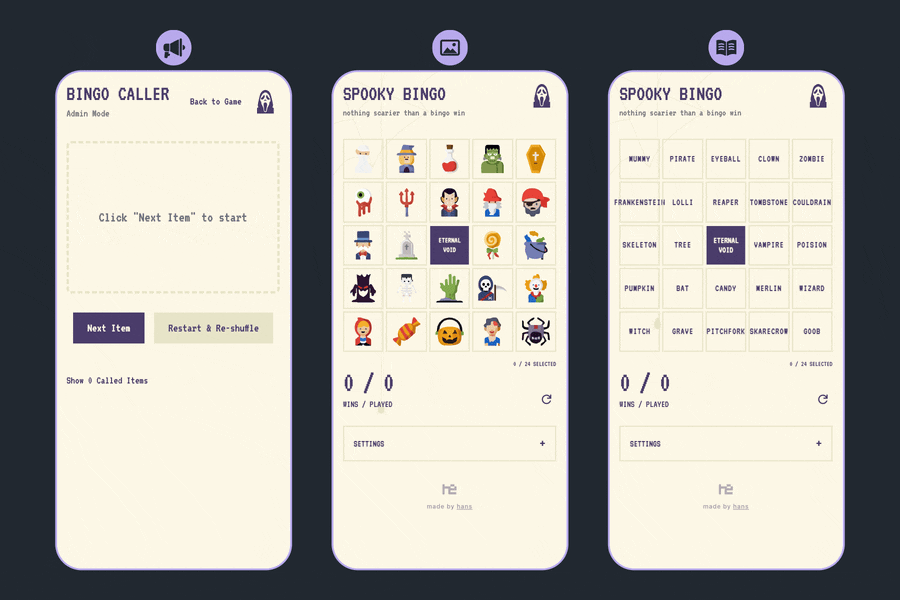
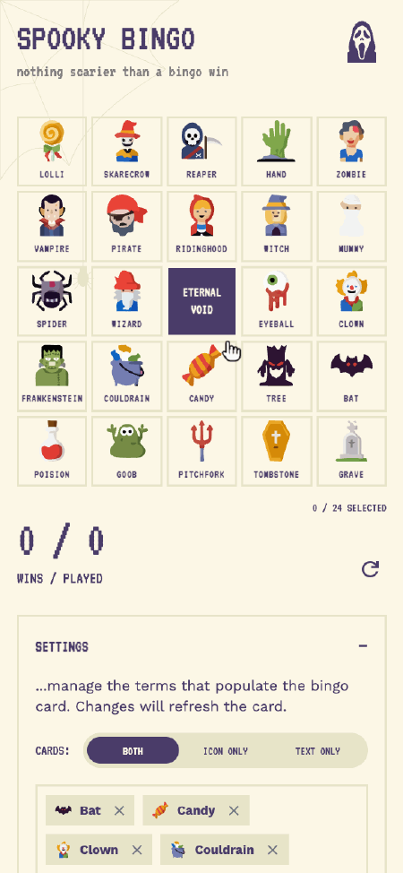
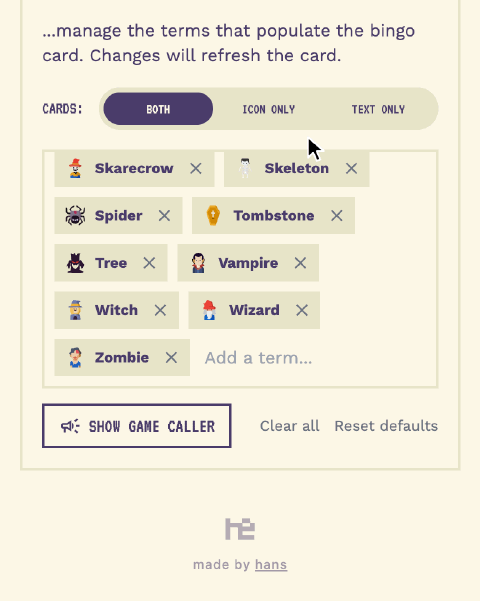
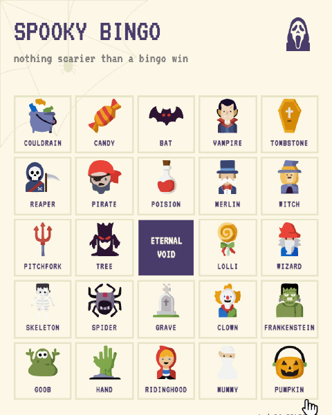

# `bingo`

My son is learning to read, my daughter is still too young. We wanted to play some bingo with both of them, so made this.

  
[<kbd> haaans.com/bingo  </kbd>](https://haaans.com/bingo)

## Features

<table>
<tr valign="top">
<td width="50%">
<h3>Play with icons, words, or both</h3>
</td>
<td width="50%">

</td>
</tr>
<tr valign="top">
<td width="50%">

</td>
<td width="50%">
<h3>List based bingo cards</h3>
</td>
</tr>
<tr valign="top">
<td width="50%">
<h3>Get spooky</h3>

SVG characters, and extra spooky mode.

</td>
<td width="50%">

</td>
</tr>
</table>
