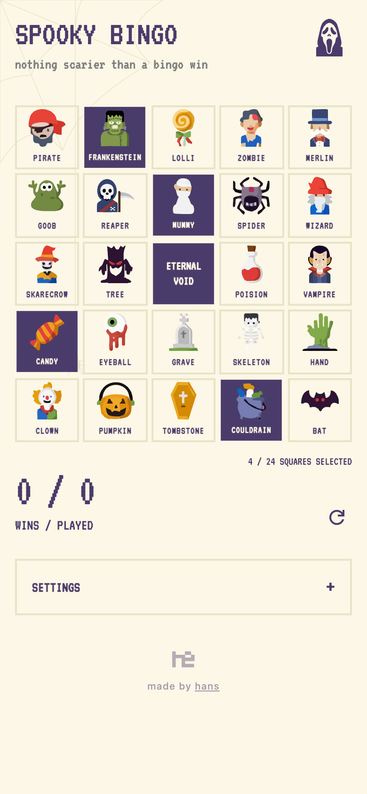
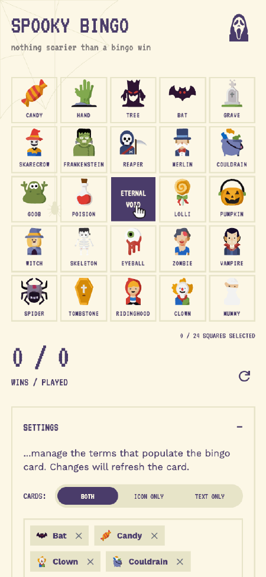
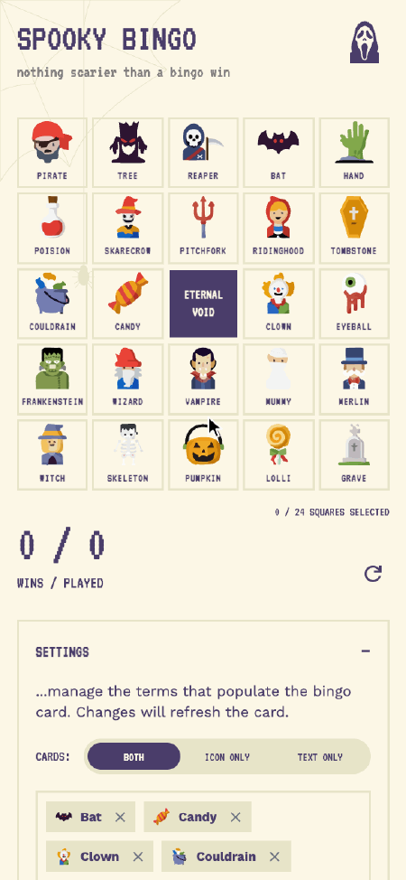
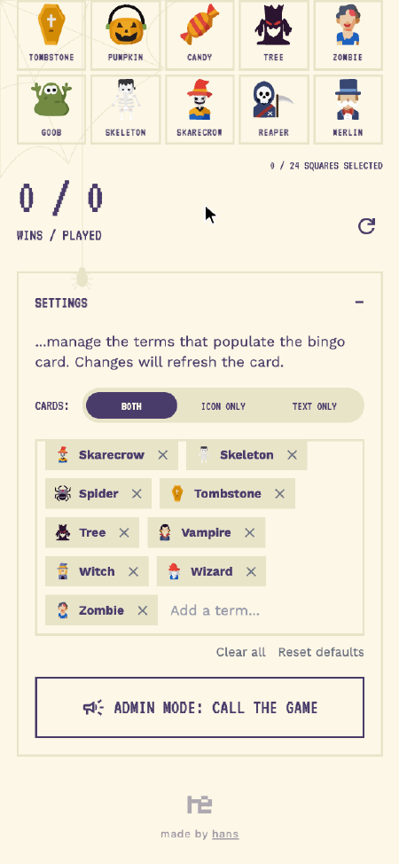
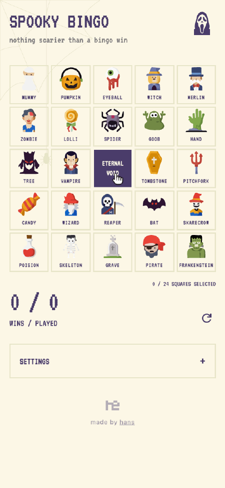

# `bingo`

A Halloween bingo card for kids and spooky movie nights: tap the squares as things show up, and a caller screen draws the terms for you.

  
[<kbd> haaans.com/bingo  </kbd>](https://haaans.com/bingo)

## Features

<table>
<tr valign="top">
<td width="50%">
<h3>Play with icons, words, or both</h3>

Tap squares to mark them, then flip the card between pictures, words, or both. Icons work for little kids who can't read yet.

</td>
<td width="50%">

</td>
</tr>
<tr valign="top">
<td width="50%">

</td>
<td width="50%">
<h3>Call the game in admin mode</h3>

Open Admin Mode from Settings and hit Next Item to draw a random term, big enough for the whole room to see.

</td>
</tr>
<tr valign="top">
<td width="50%">
<h3>Add your own terms</h3>

Type a term and press Enter to add it to the deck. Tap its icon to cycle through the spooky icons until one fits.

</td>
<td width="50%">

</td>
</tr>
<tr valign="top">
<td width="50%">

</td>
<td width="50%">
<h3>Go spookier</h3>

Tap the ghost to switch the whole card to the dark purple night mode.

</td>
</tr>
</table>
