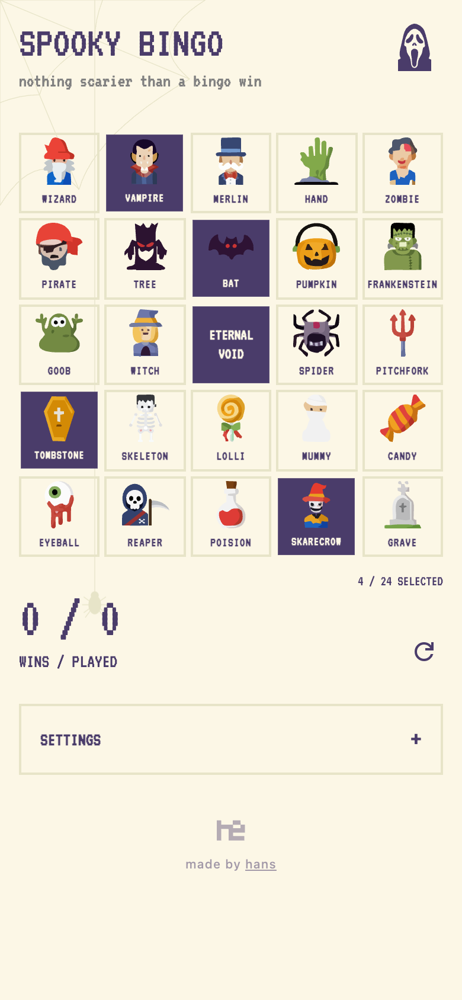
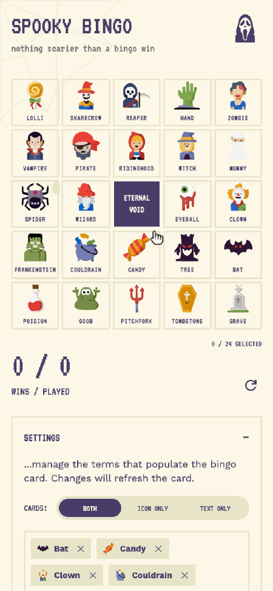
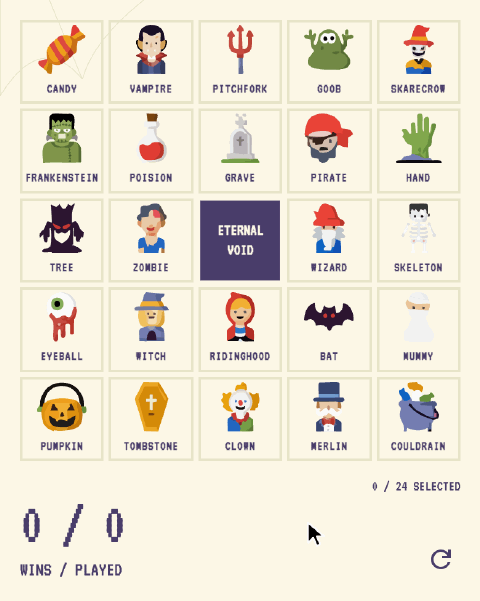
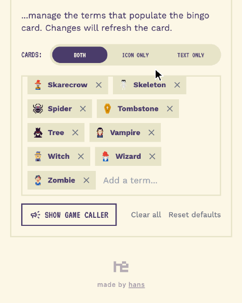
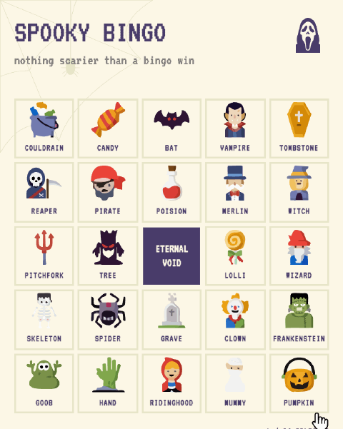
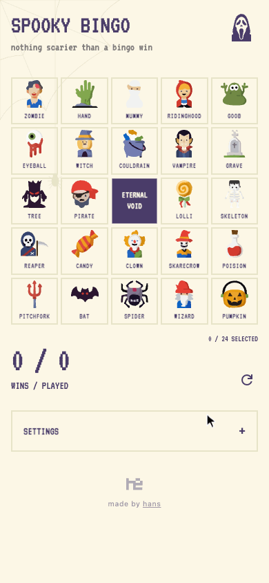
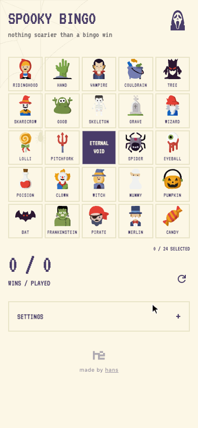
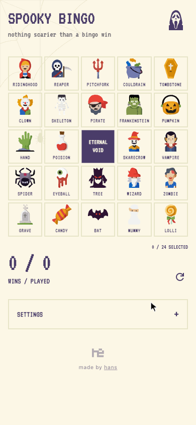
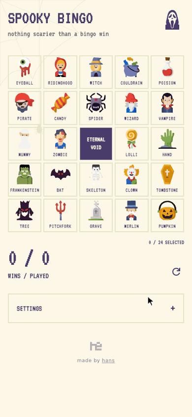
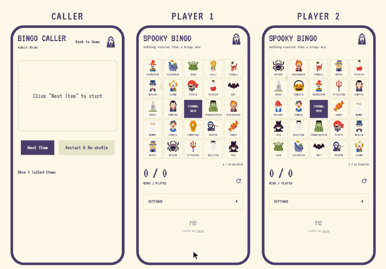

# `bingo`

Halloween bingo for kids and spooky movie nights: tap the monsters as they show up, and every bingo ends in a surprise.

  
[<kbd> haaans.com/bingo  </kbd>](https://haaans.com/bingo)

## Features

<table>
<tr valign="top">
<td width="50%">
<h3>Play with icons, words, or both</h3>

Kids who can't read yet play with pictures, kids learning to spell play with words, and everyone plays the same game at the same time. Switch the card between icons, words, or both in Settings.

</td>
<td width="50%">

</td>
</tr>
<tr valign="top">
<td width="50%">

</td>
<td width="50%">
<h3>Get a different card every time</h3>

Every new game shuffles the deck into a fresh card, so no two players are hunting for the same squares in the same order.

</td>
</tr>
<tr valign="top">
<td width="50%">
<h3>Make your own cards</h3>

Type in any term to add it to the deck: a movie's catchphrases, a family in-joke, this year's costumes. Tap a custom card's icon to flip through monsters until one fits.

</td>
<td width="50%">

</td>
</tr>
<tr valign="top">
<td width="50%">

</td>
<td width="50%">
<h3>Turn the lights out for spookier mode</h3>

Twenty-seven hand-drawn monsters, from Frankenstein to a slightly worried eyeball. Tap the ghost and the whole card goes dark for after-sunset games.

</td>
</tr>
<tr valign="top">
<td colspan="2">
<h3>Win to a surprise</h3>

Every bingo plays one of four celebrations at random: the winning row comes alive, candy explodes everywhere, a ghost jumps out, or the monsters break into a conga line. Then a spider lowers a swinging BINGO sign.

</td>
</tr>
<tr valign="top">
<td colspan="2">
<h3>Call the game from another phone</h3>

One phone runs the caller and draws a random monster each turn, while every player marks it off on their own device. Open it from Settings → Show game caller.

</td>
</tr>
</table>
